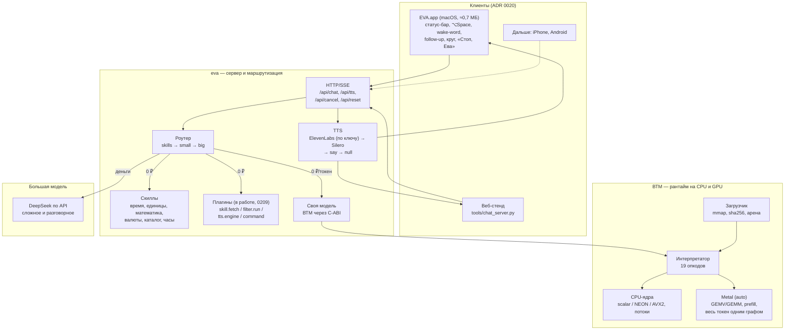
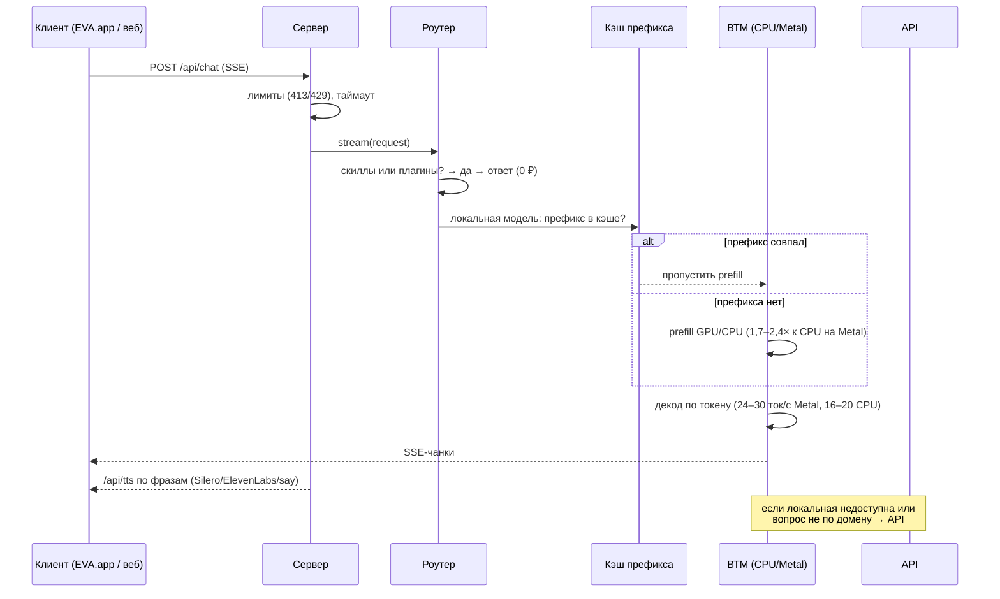
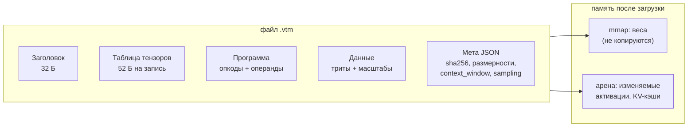
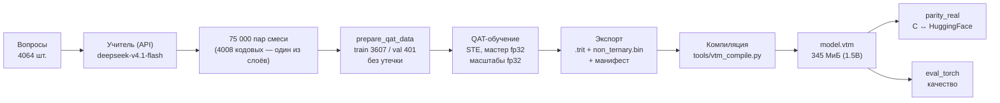

# EVA32 — устройство системы

> Актуально на 2026-11-26.

> Документ описывает, **как всё устроено сейчас** (2026-11-26), чем это проверено и куда
> движется. Все числа — с указанием задачи, из которой они получены; если число не
> измерено, так и написано. Реестр задач: [`ai/tasks/index.json`](../ai/tasks/index.json).

## 1. Что это такое

EVA32 — голосовой и текстовый ассистент для мессенджера/CRM orioncode, собранный из
**пяти слоёв**, которые работают вместе:

1. **Клиенты** — нативное приложение `EVA.app` (macOS: статус-бар, ⌥Space, wake-word,
   follow-up, круг состояний, «Стоп, Ева»; ≈0,7 МБ) и веб-стенд
   `tools/chat_server.py` для тестов и замеров. Клиент — тонкий: модель считает
   сервер ([ADR 0020](adr/0020-clients-and-cloud.md)). Дальше — iPhone и Android.
2. **Гибридный маршрутизатор** — решает, кто отвечает: скилл (0 ₽), своя модель на CPU
   (0 ₽ за токен) или большая модель по API (деньги).
3. **Своя троичная машина (ВТМ)** — рантайм `.vtm` для весов в {−1, 0, +1} на обычном
   процессоре и на Metal. Сейчас в нём считаются **3B Q4/Q4_K** (1,92–2,245 ГиБ;
   [0155](../ai/tasks/0155-stream-q4-writer.md), [0160](../ai/tasks/0160-q4-asym-import.md)),
   **7B Q4** (3,831 ГиБ, [0156](../ai/tasks/0156-q4-7b.md)) и **30B MoE**
   (Qwen3-30B-A3B, 17,28 ГиБ, [0174](../ai/tasks/0174-stream-import.md)); обученная
   тритовая 1.5B — цель QAT ([0008](../ai/tasks/0008-qat-pilot-run.md)).
4. **Данные, обучение и расширения** — смесь **75 000** пар (код 45,4%, бизнес 35,0%,
   общее 17,4%, поведение 2,2%), собранная дистилляцией и генерацией; QAT с троичными
   весами ([data-plan.md](data-plan.md)); плагины как слой расширения
   ([ADR 0022](adr/0022-plugins.md), в работе — [0209](../ai/tasks/0209-plugin-runtime.md)).
5. **Эксплуатация** — сервер с метриками, лимитами и деградацией, Docker-образ,
   рунбуки аренды и подъёма на GPU ([0108](../ai/tasks/0108-server-limits.md),
   [gpu-checklist.md](gpu-checklist.md), [rental-runbook.md](rental-runbook.md)).

**Чего это не заменяет.** Это не «модель уровня DeepSeek». По вычислениям разрыв с
DeepSeek-V3 порядка 10⁶ раз (1,5 млрд параметров против 671 млрд, ~6 млн токенов против
14,8 трлн). Наша ставка другая: **узкий эксперт, который работает на своих процессорах и
стоит почти ничего**, плюс API для сложного.

## 2. Архитектура: клиенты, сервер, ВТМ



**Почему именно так.** Скиллы отвечают мгновенно и бесплатно там, где ответ — это
вычисление или справочник. Своя модель берёт типовые вопросы по домену. API — всё
остальное. Замер на 80 вопросах: **55% закрывают скиллы**, и цена падает с 468 ₽ до
**128,94 ₽ за 1000 запросов** ([0105](../ai/tasks/0105-golden-classes.md),
[0119](../ai/tasks/0119-prompt-shorten.md)).

**Где считается модель.** До 2026-11-26 ВТМ был чисто процессорным. Теперь `auto`
выбирает **Metal**, если он собран и в машине есть GPU: декод 3B Q4_K — **24–30 ток/с**
против **16–20** на CPU simd, prefill — **1,7–2,4×** быстрее CPU
([0204](../ai/tasks/0204-metal-phase3.md), [0198](../ai/tasks/0198-hybrid-gpu-prefill.md),
[ADR 0021](adr/0021-metal-gpu-backend.md)). Гибрид (`VTM_BACKEND=hybrid`) считает
prefill на GPU, а декод — теми же NEON-ядрами на CPU; без Metal всё откатывается на
SIMD, и это проверяется тестами.

**Расширения.** Плагин — каталог `plugins/<id>/` с манифестом `plugin.json` и
способностями `skill.fetch`, `filter.run`, `tts.engine`, `command`; ядро знает только
«вызови скиллы, подложи факты, прогони фильтры» ([ADR 0022](adr/0022-plugins.md),
[plugins.md](plugins.md)). Реализация — в работе (0209), поэтому на схеме слой помечен,
но ещё не является обязательным путём.

## 3. Путь одного запроса



Что важно в этом пути:

- **Кэш префикса** ([0081](../ai/tasks/0081-vtm-prompt-cache.md),
  [0087](../ai/tasks/0087-api-cache.md), [0112](../ai/tasks/0112-prefill-batch.md)):
  системный промпт считается один раз за сессию. Повторный запрос — **11×**, а в
  prefill-доминантном случае через C-ABI — до **125×**. Без этого говорить о диалоге
  было бы нельзя.
- **Prefill** ([0112](../ai/tasks/0112-prefill-batch.md),
  [0189](../ai/tasks/0189-dense-prefill-gemm.md), [0198](../ai/tasks/0198-hybrid-gpu-prefill.md)):
  промпт считается пачкой; на Metal это **1,7–2,4×** быстрее CPU. TTFT свежего
  диалога (прогретая модель, кэш системного промпта) — **0,34–0,35 с**, на чистом
  CPU — **1,6–1,9 с** ([0198](../ai/tasks/0198-hybrid-gpu-prefill.md),
  [0204](../ai/tasks/0204-metal-phase3.md)).
- **Деградация** ([0108](../ai/tasks/0108-server-limits.md)): big → локальная → скилл →
  503. Обрыв клиента отменяет генерацию, а не жжёт токены в пустоту.
- **Голос** ([voice-app.md](voice-app.md), [hybrid.md](hybrid.md)): клиент распознаёт речь
  на устройстве (Apple Speech), сервер отдаёт текст и WAV/MP3 по фразам. Локальный
  синтез — **Silero** (`baya` по умолчанию); если задан `ELEVENLABS_API_KEY`,
  автовыбор берёт **ElevenLabs** раньше Silero; **`say`** — аварийный движок, иначе
  null ([0193](../ai/tasks/0193-silero-tts.md), [0195](../ai/tasks/0195-silero-worker.md),
  [0197](../ai/tasks/0197-switch-to-silero-only.md), [0191](../ai/tasks/0191-elevenlabs-tts.md)).

## 4. ВТМ: как модель работает без видеокарты

### 4.1 Контейнер `.vtm`



- **Формат:** версия v0.2, триты упакованы по 20 в 32-битное слово (1,585 бита на
  вес без масштабов). Итог: **1,71 бита на вес с масштабами** — измерено на реальной
  модели ([0095](../ai/tasks/0095-tiny-qat-cpu.md)).
- **KV-кэши в файл не пишутся** ([0101](../ai/tasks/0101-kv-lazy-alloc.md),
  [ADR 0015](adr/0015-kv-out-of-file.md)): это экономит 112 МиБ на 1.5B. Старые бинари
  получают внятный отказ, а не мусор.
- **Целостность:** sha256 секции данных и меты, проверка при загрузке
  ([0066](../ai/tasks/0066-vtm-integrity.md)); аппаратный SHA на ARM — **8,7×**
  ([0078](../ai/tasks/0078-vtm-sha-fast.md)).

### 4.2 Интерпретатор

19 опкодов: `TMV` (трит × вектор), `MM`, `RMSN`, `ROPE`, `SM`, `SILU`, `MUL`, `ADD`,
`EMB`, `KVW`, `ATTN`, `SAMP`, `CPY`, `SCAL`, `HALT`, `MOE` (весь MoE-блок одной
инструкцией), `RMSH` (QK-norm по голове), `CONV4` (короткая свёртка gated delta),
`GDELTA` (шаг gated delta rule). Программа — линейный список инструкций; позиция и
`input_token` живут в состоянии машины. Сверка с кодом —
`python3 tools/check_vtm_docs.py`.

**Почему интерпретатор, а не CUDA.** Мы целимся в процессоры заказчика: там нет
видеокарт, а троичные веса в 10 раз меньше по объёму и считаются целочисленно.
Когда GPU есть, тот же байткод исполняет бэкенд Metal — меняется исполнитель, не
формат модели ([ADR 0021](adr/0021-metal-gpu-backend.md)).

### 4.3 Память и скорость (форма Qwen2.5-1.5B, замер [0103](../ai/tasks/0103-bench-shape.md))

| Что | Значение |
|---|---|
| Файл контейнера | **345,3 МиБ** (триты 294,4 + масштабы 46,0 + fp32 4,8) |
| RSS при mmap | **353 МиБ** |
| RSS без mmap | 693 МиБ |
| Декод | **15,4 ток/с** (4 потока) / **18,2** (8 потоков) |
| Prefill 16 токенов, пачкой | **2,6 с** (было 22,6 с) |
| Первый ответ (промпт 500 токенов) | ~11 с |
| Второй ответ в сессии | **~1 с** (кэш префикса) |

Потолок не в памяти, а в счёте: `prefill 512 токенов = 1,8 TFLOP`, что при 37,6 с даёт
48 GFLOP/s — 24% пика M1 Pro. Больше 2× на четырёх потоках физически не выжать
([0112](../ai/tasks/0112-prefill-batch.md)).

### 4.4 Что внутри модели троичное, а что нет

```
троичные (28 тензоров): q, k, v, o, gate, up, down — 7 проекций × 4 слоя
float (79 тензоров):    эмбеддинг*, нормы, bias, масштабы, KV-кэши
```

\* эмбеддинг тоже переводится в триты (решение [0099](../ai/tasks/0099-trit-embeddings.md)):
у 1.5B это 445 МиБ → ~56 МиБ. Риск — при tied-весах он же выходной слой; качество логитов
обязательно проверять на eval.

Проверка троичности — не на слово, а распаковкой: `python3 tools/check_ternary.py <файл.trit>`
показывает распределение и **ноль** значений вне {−1, 0, +1}.

### 4.5 GPU (Metal) и MoE: то, что не влезает в «просто CPU»

**Metal** ([ADR 0021](adr/0021-metal-gpu-backend.md),
[0192](../ai/tasks/0192-metal-gemv.md), [0196](../ai/tasks/0196-metal-phase2.md),
[0198](../ai/tasks/0198-hybrid-gpu-prefill.md), [0204](../ai/tasks/0204-metal-phase3.md)).
Веса не копируются: контейнер mmap'ится, `MTLBuffer` создаётся
`newBufferWithBytesNoCopy` (zero-copy, 0 байт копий). Фаза 3 кодирует **весь токен в
один командный буфер** (RMSNorm/RoPE/SiLU/KVW/attention — MSL-ядра), CPU только
сэмплирует. Результат: декод **24–30 ток/с** против **16–20** на CPU, prefill
**1,7–2,4×** CPU; точность — `max|Δlogits|` ≈ 5–6e-5 при допуске 1e-2, argmax
совпадает. `auto` включает Metal, только если быстрее и декод, и prefill; ошибка
командного буфера откатывает токен на CPU и выключает Metal. Граф поддерживает
kind 4/6/7 (Q4_K/Q6_K) при `n == 1`; **kind 5 (Q4_0/Q4_1), триты, MoE и плотные
веса идут прежним путём** — для них Metal не ускоряет декод.

**MoE** ([moe.md](moe.md), [0174](../ai/tasks/0174-stream-import.md),
[0175](../ai/tasks/0175-moe-pread-cache.md), [0177](../ai/tasks/0177-moe-speed.md),
[0180](../ai/tasks/0180-cache-plus-batch.md)). Qwen3-30B-A3B — **17,28 ГиБ**
(v0.3, u64), в 16 ГиБ целиком не живёт, поэтому эксперты читаются с диска:
`pread` в LRU-кэш (`VTM_MOE_CACHE_MB=1792`), 6 I/O-потоков параллельно со счётом,
батчевый prefill. На M1 Pro: **1,88 ток/с**, TTFT **13,4 с**; узкое место — диск
(4,09 ГиБ `pread` на прогон при ~3,4 ГБ/с), а не ядра. Это режим «работает, но
медленно», а не продуктовая скорость.

## 5. Обучение: от данных до файла `.vtm`



Схема — путь **QAT-тритов** (цель). В рантайме с 2026-11-24 работает другая ветка:
готовые веса Qwen 3B/7B из GGUF → kind 5 (Q4) → `.vtm` (задачи 0153–0156), без обучения.
Она и даёт живые числа скорости; качество тритов появится только после QAT.

- **Дистилляция** ([0045](../ai/tasks/0045-code-data.md)): 4008 уникальных пар, 0 дублей,
  средняя длина ответа 1767 символов. Учитель вызван с `reasoning.enabled: false` —
  иначе платим за токены, которые не идут в обучение.
- **Данные для ассистента**: 15,6% пар длиннее контекста 2048; политика — **обрезать**, а
  не выбрасывать ([0097](../ai/tasks/0097-training-policies.md)).
- **Масштабы fp32** ([0095](../ai/tasks/0095-tiny-qat-cpu.md),
  [0099](../ai/tasks/0099-trit-embeddings.md)): fp16 даёт `max|Δ|` 1,7e-03 (4,3e-03 с
  тритовым эмбеддингом), fp32 — 2,1e-06. Цена — ~2% размера.
- **Сквозная проверка на крошечной модели** ([0095](../ai/tasks/0095-tiny-qat-cpu.md)):
  4 млн параметров, 136 с на CPU, loss 5,58 → 1,57, `max|Δ| C↔HF = 2,1e-06`. Это
  доказало работоспособность конвейера **до** аренды GPU.
- **KL-дистилляция** ([0107](../ai/tasks/0107-kl-distill.md)): работает, но full-vocab
  логиты не масштабируются (116 МиБ на пару); нужен top-k
  ([0111](../ai/tasks/0111-topk-logits.md)).

## 6. Практика: что делать руками

### Запустить модель локально

```bash
cd src/vtm && make                       # libvtm.a + vtm (auto = SIMD, если есть)
./vtm run ../../demo/model.vtm --tokens 1,2,3 --max-new 8
./vtm run model.vtm --tokens 1,2,3 --max-new 32 --prefill-batch 16 --stream
./vtm run model.vtm --tokens 1,2,3 --max-new 32 --trace-summary   # профиль по опкодам
```

### Запустить сервер

```bash
export EVA_VTM_MODEL=runs/pilot1/export/model.vtm
export EVA_VTM_CACHE=1          # кэш префикса: второй запрос ~1 с
export EVA_VTM_PREFILL_BATCH=16 # промпт пачками (скалярный бэкенд)
python3 -m eva.cli serve --port 8080
curl localhost:8080/metrics | python3 -m json.tool
```

### Проверить всё одной командой

```bash
python3 tools/ci.py     # C-сборка, тесты, UBSan, Python, реестр, доки, скорость — 35 с
```

### Обучить (когда будет GPU)

```bash
python3 -m qat.train --config qat/configs/qwen1.5b.yaml --dry-run   # сначала память
python3 -m qat.train --config qat/configs/qwen1.5b.yaml --out runs/pilot1
python3 -m qat.export --run runs/pilot1 --out runs/pilot1/export
python3 tools/vtm_compile.py --manifest runs/pilot1/export/manifest.json --out model.vtm
# runs/pilot1 — артефакт прогона (gitignored), а не путь в репозитории
python3 tools/parity_real.py --model Qwen/Qwen2.5-1.5B-Instruct   # сверка с HF
```

### Проверить, что веса действительно троичные

```bash
python3 tools/check_ternary.py <export>/ternary.trit
# ожидаемо: вне {-1,0,+1}: 0
```

## 7. Где мы сейчас

| Слой | Состояние | Чем подтверждено |
|---|---|---|
| Клиенты | EVA.app ≈0,7 МБ: ⌥Space, wake-word, follow-up, круг, компакт, «Стоп, Ева»; веб-стенд | 0184, 0186–0190, 0194; ADR 0020 |
| Маршрутизация | каталог 45/45, скиллы 44/45, 10,42 ₽/1000; набор 80 — 80/80, 44/80, 128,94 ₽ | `eval_hybrid.py` |
| ВТМ — модели | 3B Q4 2,245 ГиБ / Q4_0 1,92 ГиБ; 7B Q4 3,831 ГиБ (95,79%); 30B MoE 17,28 ГиБ | 0155, 0156, 0160, 0174 |
| ВТМ — скорость | 3B Q4_K: **24–30 ток/с** Metal, **16–20** CPU simd; prefill **1,7–2,4×**; 30B MoE **1,88 ток/с** | 0204, 0198, 0177, 0180 |
| ВТМ — память | KV вне файла (−112 МиБ на 1.5B-форме); zero-copy Metal (0 копий весов) | 0101, 0204 |
| Обучение | конвейер QAT→export→`.vtm`→C проверен на tiny | 0095 |
| Данные | 75 000 пар смеси (4008 кодовых — один слой) | data-plan, 0045 |
| Голос | Silero `baya`/`kseniya`/`xenia`: 0,04–0,18 с на фразу после prewarm, worker 0,84–0,93 ГБ; ElevenLabs по ключу; `say` — аварийно | 0193, 0195, 0197, 0191 |
| QAT на 1.5B/3B | **не запускался** (нет GPU) | 0008 blocked |
| Сервер | метрики, лимиты, деградация, прогрев, шаблон Qwen и бюджет размышлений | 0108, 0115, 0200 |
| Плагины | контракт (манифест, способности, права) — **в работе** | 0209, ADR 0022 |
| Тесты | Python-набор + C-набор + UBSan, CI ubuntu+macos | `tools/ci.py` |

Реестр: **201 задача — 183 закрыто, 8 ожидает, 8 в работе, 2 заблокированы**
(`python3 tools/check_tasks.py`).

## 8. Куда движется проект

### Ближайшее

| Шаг | Зачем | Цена |
|---|---|---|
| **QAT на аренде** ([0008](../ai/tasks/0008-qat-pilot-run.md)) | обученная тритовая модель, качество «до/после» | 600–900 ₽ |
| 30B MoE быстрее ([0177](../ai/tasks/0177-moe-speed.md), [0181](../ai/tasks/0181-moe-batch-bigger.md)) | меньше байт на токен: Q3-контейнер, int8-батчевое ядро kind 6/7 | 0 ₽ |
| Смешанная точность / AWQ ([0146](../ai/tasks/0146-exp-mixed.md), [0147](../ai/tasks/0147-exp-smart.md)) | точность без полного QAT | 0 ₽ |
| Плагины ([0209](../ai/tasks/0209-plugin-runtime.md)) | рост возможностей без правки ядра | 0 ₽ |
| Клиенты iPhone/Android ([ADR 0020](adr/0020-clients-and-cloud.md)) | продукт вместо стенда; модель остаётся на сервере | 0 ₽ |
| u64/шардинг ([0141](../ai/tasks/0141-vtm-u64-offsets.md)) | 32B в ВТМ — если понадобится | 0 ₽ |

### Аренда GPU (когда появится доступ)

1. Два коротких прогона по 100 шагов: lr 3e-5 против 1e-4 — выбрать по val loss
   (свип на tiny показал минимум около 5e-4 при 4M параметров, для 1.5B это ~3e-5, но
   проверять надо).
2. Полный прогон: 3 эпохи = ~350 шагов, 2,1 ч, 192–256 ₽.
3. Экспорт → `.vtm` → `parity_real` → `eval_torch` → замер скорости на сервере.

### Развилки, которые ещё не решены

- **Размер модели.** 3B на Metal даёт 24–30 ток/с, 7B — 4,5 ток/с; 30B MoE живёт
  только за счёт чтения экспертов с диска (1,88 ток/с). Вопрос не «какая больше», а
  «какая нужна в продукте, а какая — через API».
- **Metal только для kind 4/6/7.** Q4_1 (kind 5), триты и MoE на GPU не ускорены;
  переносить ли Q4_1/MoE на Metal — открытый вопрос, который решает замер, а не вера.
- **Плагины и облако.** Для мультиарендности (ADR 0020) нужны «чьи плагины, чьи
  права»; `owner` в манифесте заложен, песочница — отдельный шаг.
- **Тритовый эмбеддинг при tied-весах.** Экономит 390 МиБ, но выходной слой тоже
  квантуется — нужен замер качества, иначе откатить одно поле.

### Принципы, на которых это держится

1. **Числа с источником.** Каждое утверждение в документах ссылается на задачу, в
   которой его измерили. Не измерено — так и написано.
2. **Проверка запуском, а не отчётом.** Приёмка — `git clone` + `tools/ci.py`, а не
   «агент сказал, что зелено». За сессию это трижды ловило красное.
3. **Не ставить невыполнимых целей.** Если хотим «10×», сначала считаем работу и пик
   железа; здесь это уже дало две отмены критериев.
4. **Обратное решение должно быть дешёвым.** fp32/fp16, trit/none для эмбеддинга, окно
   контекста — всё переключается одним полем конфига.

## 9. Что не сделано и где риски

- **Обученной тритовой модели нет.** Числа Q4 получены на готовой Qwen (0155/0160) —
  это про объём, скорость и постичь-качество, а не про QAT. Тритовая ветка ждёт GPU (0008).
- **Качество Q4 измерено частично.** rel-RMS 5,1% и 20 строк golden: clarify 2/8,
  часть ответов уходит в таймаут на prefill ([0162](../ai/tasks/0162-q4-prefill-batch.md)).
- **30B MoE — режим «работает», а не продукт.** 1,88 ток/с и TTFT 13,4 с упираются в
  диск; на 16 ГиБ модель не держится в page cache ([0177](../ai/tasks/0177-moe-speed.md),
  [0180](../ai/tasks/0180-cache-plus-batch.md)).
- **Metal не для всех форматов.** kind 5 (Q4_0/Q4_1), триты, MoE и плотные веса идут
  CPU-путём; `auto` выбирает Metal только при поддержанном графе
  ([0204](../ai/tasks/0204-metal-phase3.md)).
- **Один пользователь = одна машина.** C-ABI не потокобезопасен для генерации; сервер
  держит контекст на запрос.
- **Плагины — код, который мы запускаем.** Permissions — best-effort; полноценной
  песочницы нет ([ADR 0022](adr/0022-plugins.md)).
- **Windows и big-endian** не поддерживаются: явный отказ, а не порт.
- **Кэш промпта не переживает рестарт**: снимки KV есть ([0079](../ai/tasks/0079-vtm-kv-session.md)),
  но состояние сэмплера в них не сохраняется.
