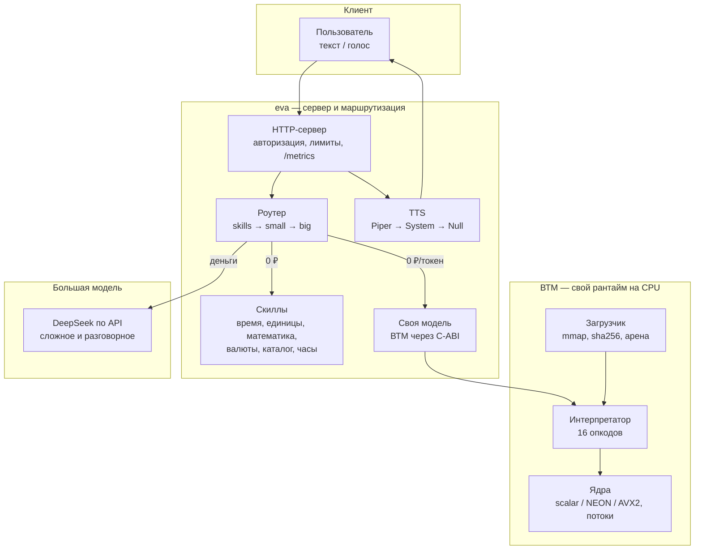
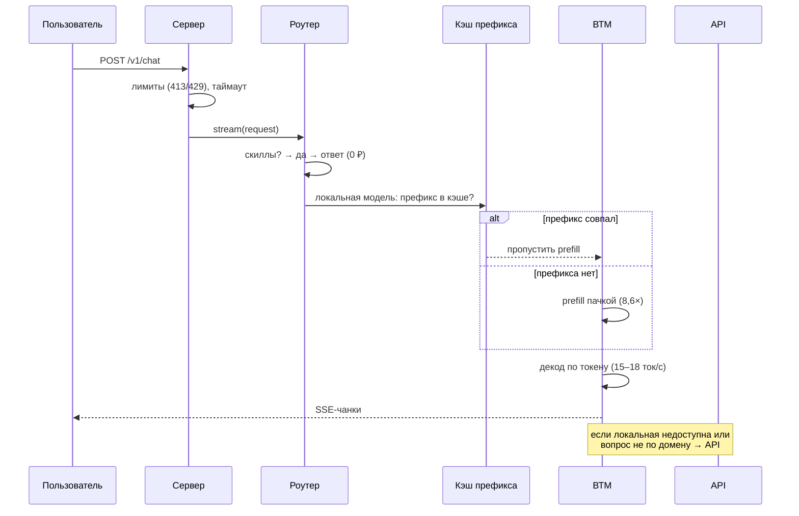
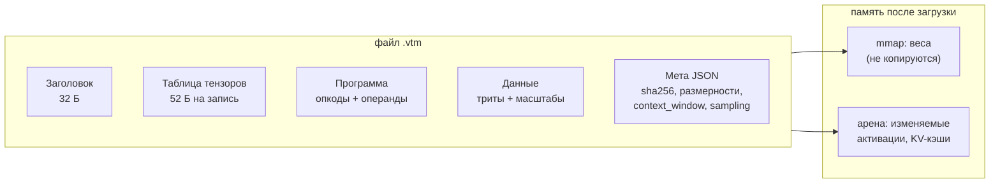
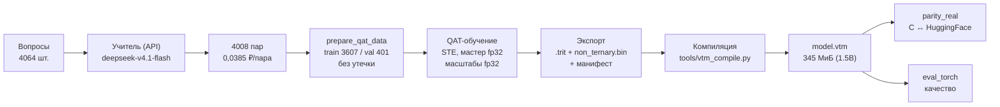

# EVA32 — устройство системы

> Документ описывает, **как всё устроено сейчас** (2026-11-18), чем это проверено и куда
> движется. Все числа — с указанием задачи, из которой они получены; если число не
> измерено, так и написано. Реестр задач: [`ai/tasks/index.json`](../ai/tasks/index.json).

## 1. Что это такое

EVA32 — голосовой и текстовый ассистент для мессенджера/CRM orioncode, собранный из
**четырёх слоёв**, которые работают вместе:

1. **Гибридный маршрутизатор** — решает, кто отвечает: скилл (0 ₽), своя модель на CPU
   (0 ₽ за токен) или большая модель по API (деньги).
2. **Своя троичная модель (ВТМ)** — 1.5B параметров в весах {−1, 0, +1}, работает на
   обычном процессоре, без видеокарты.
3. **Данные и обучение** — 4008 пар «вопрос → ответ» по программированию, полученных
   дистилляцией от учителя; QAT-обучение с троичными весами.
4. **Эксплуатация** — сервер с метриками и деградацией, Docker-образ, рунбуки аренды.

**Чего это не заменяет.** Это не «модель уровня DeepSeek». По вычислениям разрыв с
DeepSeek-V3 порядка 10⁶ раз (1,5 млрд параметров против 671 млрд, ~6 млн токенов против
14,8 трлн). Наша ставка другая: **узкий эксперт, который работает на своих процессорах и
стоит почти ничего**, плюс API для сложного.

## 2. Архитектура: четыре слоя



**Почему именно так.** Скиллы отвечают мгновенно и бесплатно там, где ответ — это
вычисление или справочник. Своя модель берёт типовые вопросы по домену. API — всё
остальное. Замер на 80 вопросах: **55% закрывают скиллы**, и цена падает с 468 ₽ до
**128,94 ₽ за 1000 запросов** ([0105](../ai/tasks/0105-golden-classes.md),
[0119](../ai/tasks/0119-prompt-shorten.md)).

## 3. Путь одного запроса



Что важно в этом пути:

- **Кэш префикса** ([0081](../ai/tasks/0081-vtm-prompt-cache.md),
  [0087](../ai/tasks/0087-api-cache.md), [0112](../ai/tasks/0112-prefill-batch.md)):
  системный промпт считается один раз за сессию. Повторный запрос — **11×**, а в
  prefill-доминантном случае через C-ABI — до **125×**. Без этого говорить о диалоге
  было бы нельзя.
- **Батчевый prefill** ([0112](../ai/tasks/0112-prefill-batch.md)): промпт считается
  пачками до 16 токенов, на скалярном бэкенде это **8,6×** (22,6 с → 2,6 с на 16 токенах).
- **Деградация** ([0108](../ai/tasks/0108-server-limits.md)): big → локальная → скилл →
  503. Обрыв клиента отменяет генерацию, а не жжёт токены в пустоту.

## 4. ВТМ: как модель работает без видеокарты

### 4.1 Контейнер `.vtm`



- **Формат:** версия v0.2, триты упакованы по 20 в 32-битное слово (1,585 бита на
  вес без масштабов). Итог: **1,71 бита на вес с масштабами** — измерено на реальной
  модели ([0095](../ai/tasks/0095-tiny-qat-cpu.md)).
- **KV-кэши в файл не пишутся** ([0101](../ai/tasks/0101-kv-lazy-alloc.md),
  [ADR 0015](adr/0015-kv-out-of-file.md)): это экономит 112 МиБ на 1.5B. Старые бинари
  получают внятный отказ, а не мусор.
- **Целостность:** sha256 секции данных и меты, проверка при загрузке
  ([0066](../ai/tasks/0066-vtm-integrity.md)); аппаратный SHA на ARM — **8,7×**
  ([0078](../ai/tasks/0078-vtm-sha-fast.md)).

### 4.2 Интерпретатор

16 опкодов: `TMV` (трит × вектор), `MM`, `RMSN`, `ROPE`, `SM`, `SILU`, `MUL`, `ADD`,
`EMB`, `KVW`, `ATTN`, `SAMP`, `CPY`, `SCAL`, `HALT`. Программа — линейный список
инструкций; позиция и `input_token` живут в состоянии машины.

**Почему интерпретатор, а не CUDA.** Мы целимся в процессоры заказчика: там нет
видеокарт, а троичные веса в 10 раз меньше по объёму и считаются целочисленно.

### 4.3 Память и скорость (форма Qwen2.5-1.5B, замер [0103](../ai/tasks/0103-bench-shape.md))

| Что | Значение |
|---|---|
| Файл контейнера | **345,3 МиБ** (триты 294,4 + масштабы 46,0 + fp32 4,8) |
| RSS при mmap | **353 МиБ** |
| RSS без mmap | 693 МиБ |
| Декод | **15,4 ток/с** (4 потока) / **18,2** (8 потоков) |
| Prefill 16 токенов, пачкой | **2,6 с** (было 22,6 с) |
| Первый ответ (промпт 500 токенов) | ~11 с |
| Второй ответ в сессии | **~1 с** (кэш префикса) |

Потолок не в памяти, а в счёте: `prefill 512 токенов = 1,8 TFLOP`, что при 37,6 с даёт
48 GFLOP/s — 24% пика M1 Pro. Больше 2× на четырёх потоках физически не выжать
([0112](../ai/tasks/0112-prefill-batch.md)).

### 4.4 Что внутри модели троичное, а что нет

```
троичные (28 тензоров): q, k, v, o, gate, up, down — 7 проекций × 4 слоя
float (79 тензоров):    эмбеддинг*, нормы, bias, масштабы, KV-кэши
```

\* эмбеддинг тоже переводится в триты (решение [0099](../ai/tasks/0099-trit-embeddings.md)):
у 1.5B это 445 МиБ → ~56 МиБ. Риск — при tied-весах он же выходной слой; качество логитов
обязательно проверять на eval.

Проверка троичности — не на слово, а распаковкой: `python3 tools/check_ternary.py <файл.trit>`
показывает распределение и **ноль** значений вне {−1, 0, +1}.

## 5. Обучение: от данных до файла `.vtm`



- **Дистилляция** ([0045](../ai/tasks/0045-code-data.md)): 4008 уникальных пар, 0 дублей,
  средняя длина ответа 1767 символов. Учитель вызван с `reasoning.enabled: false` —
  иначе платим за токены, которые не идут в обучение.
- **Данные для ассистента**: 15,6% пар длиннее контекста 2048; политика — **обрезать**, а
  не выбрасывать ([0097](../ai/tasks/0097-training-policies.md)).
- **Масштабы fp32** ([0095](../ai/tasks/0095-tiny-qat-cpu.md),
  [0099](../ai/tasks/0099-trit-embeddings.md)): fp16 даёт `max|Δ|` 1,7e-03 (4,3e-03 с
  тритовым эмбеддингом), fp32 — 2,1e-06. Цена — ~2% размера.
- **Сквозная проверка на крошечной модели** ([0095](../ai/tasks/0095-tiny-qat-cpu.md)):
  4 млн параметров, 136 с на CPU, loss 5,58 → 1,57, `max|Δ| C↔HF = 2,1e-06`. Это
  доказало работоспособность конвейера **до** аренды GPU.
- **KL-дистилляция** ([0107](../ai/tasks/0107-kl-distill.md)): работает, но full-vocab
  логиты не масштабируются (116 МиБ на пару); нужен top-k
  ([0111](../ai/tasks/0111-topk-logits.md)).

## 6. Практика: что делать руками

### Запустить модель локально

```bash
cd src/vtm && make                       # libvtm.a + vtm (auto = SIMD, если есть)
./vtm run ../../demo/model.vtm --tokens 1,2,3 --max-new 8
./vtm run model.vtm --tokens 1,2,3 --max-new 32 --prefill-batch 16 --stream
./vtm run model.vtm --tokens 1,2,3 --max-new 32 --trace-summary   # профиль по опкодам
```

### Запустить сервер

```bash
export EVA_VTM_MODEL=runs/pilot1/export/model.vtm
export EVA_VTM_CACHE=1          # кэш префикса: второй запрос ~1 с
export EVA_VTM_PREFILL_BATCH=16 # промпт пачками (скалярный бэкенд)
python3 -m eva.cli serve --port 8080
curl localhost:8080/metrics | python3 -m json.tool
```

### Проверить всё одной командой

```bash
python3 tools/ci.py     # C-сборка, тесты, UBSan, Python, реестр, доки, скорость — 35 с
```

### Обучить (когда будет GPU)

```bash
python3 -m qat.train --config qat/configs/qwen1.5b.yaml --dry-run   # сначала память
python3 -m qat.train --config qat/configs/qwen1.5b.yaml --out runs/pilot1
python3 -m qat.export --run runs/pilot1 --out runs/pilot1/export
python3 tools/vtm_compile.py --manifest runs/pilot1/export/manifest.json --out model.vtm
python3 tools/parity_real.py --model Qwen/Qwen2.5-1.5B-Instruct   # сверка с HF
```

### Проверить, что веса действительно троичные

```bash
python3 tools/check_ternary.py runs/pilot1/export/ternary.trit
# ожидаемо: вне {-1,0,+1}: 0
```

## 7. Где мы сейчас

| Слой | Состояние | Чем подтверждено |
|---|---|---|
| Маршрутизация | 80/80 маршрутов, 55% скиллов, 128,94 ₽/1000 | `eval_hybrid.py` |
| ВТМ — рантайм | декод 15–18 ток/с, prefill 8,6×, кэш 11–125× | 0103, 0112, 0108 |
| ВТМ — память | 345 МиБ файл, 353 МиБ RSS | 0101, 0103 |
| Обучение | конвейер проверен сквозь на tiny | 0095 |
| Данные | 4008 пар | 0045 |
| QAT на 1.5B | **не запускался** (нет GPU) | 0008 blocked |
| Сервер | метрики, лимиты, деградация, прогрев | 0108, 0115 |
| Тесты | 1618 Python + C-набор + UBSan | `tools/ci.py` |

Реестр: **106 закрыто, 8 ожидает, 2 заблокированы** арендой GPU.

## 8. Куда движется проект

### Ближайшее (без GPU)

| Шаг | Зачем | Цена |
|---|---|---|
| **Данные ×10–25** (40–100 тыс. пар) | главный рычаг качества: сейчас 6 млн токенов | 1,5–4 тыс. ₽ |
| Батчевые SIMD-ядра ([0122](../ai/tasks/0122-batched-simd.md)) | prefill на дефолтном бэкенде сейчас 1,00× | 0 ₽ |
| TSan для пула ([0121](../ai/tasks/0121-tsan-pool.md)) | lock-free код не проверен санитайзером | 0 ₽ |
| Маркер `local` в телеметрии ([0109](../ai/tasks/0109-telemetry-local.md)) | посчитать, сколько ответила своя модель | 0 ₽ |

### Аренда GPU (когда появится доступ)

1. Два коротких прогона по 100 шагов: lr 3e-5 против 1e-4 — выбрать по val loss
   (свип на tiny показал минимум около 5e-4 при 4M параметров, для 1.5B это ~3e-5, но
   проверять надо).
2. Полный прогон: 3 эпохи = ~350 шагов, 2,1 ч, 192–256 ₽.
3. Экспорт → `.vtm` → `parity_real` → `eval_torch` → замер скорости на сервере.

### Развилки, которые ещё не решены

- **Размер модели.** 1.5B помещается на CPU и даёт 15–18 ток/с. 3B даст лучше качество,
  но вдвое медленнее. 7B — уже не CPU-история.
- **Тритовый эмбеддинг при tied-весах.** Экономит 390 МиБ, но выходной слой тоже
  квантуется — нужен замер качества, иначе откатить одно поле.
- **Сервер без GPU против покупки железа.** Пока модель полгигабайта, 128 ГБ
  объединённой памяти покупать не для чего.

### Принципы, на которых это держится

1. **Числа с источником.** Каждое утверждение в документах ссылается на задачу, в
   которой его измерили. Не измерено — так и написано.
2. **Проверка запуском, а не отчётом.** Приёмка — `git clone` + `tools/ci.py`, а не
   «агент сказал, что зелено». За сессию это трижды ловило красное.
3. **Не ставить невыполнимых целей.** Если хотим «10×», сначала считаем работу и пик
   железа; здесь это уже дало две отмены критериев.
4. **Обратное решение должно быть дешёвым.** fp32/fp16, trit/none для эмбеддинга, окно
   контекста — всё переключается одним полем конфига.

## 9. Что не сделано и где риски

- **Живой модели нет.** Все числа ВТМ получены на форме настоящей модели со случайными
  весами: они про объём и скорость, не про качество.
- **Качество ответов неизвестно.** `eval_torch` готов, но прогона не было.
- **Один пользователь = одна машина.** C-ABI не потокобезопасен для генерации; сервер
  держит контекст на запрос.
- **SIMD и батч не дружат.** Батчевый prefill ускоряет только скалярный бэкенд.
- **Windows и big-endian** не поддерживаются: явный отказ, а не порт.
- **Кэш промпта не переживает рестарт**: снимки KV есть ([0079](../ai/tasks/0079-vtm-kv-session.md)),
  но состояние сэмплера в них не сохраняется.
